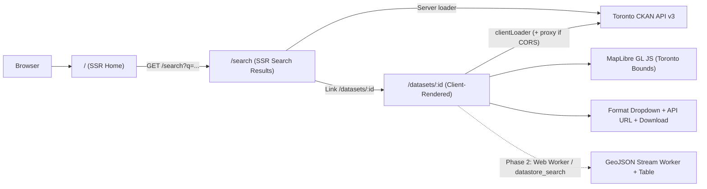

# GeoTO Full-Stack Web App Plan

Build **GeoTO**, a full-stack web app for viewing geospatial datasets from Toronto Open Data using **React Router v7** (framework mode with Vite + TypeScript + Tailwind CSS v4) and **MapLibre GL JS**, sticking closely to the GeoTO Notion spec.

## Architecture Overview

### Rendering & Data Strategy

- **SSR routes** (`/` and `/search`): Use React Router server `loader` functions (`ssr: true` in `react-router.config.ts`) so the Home and Search Results pages render on the server.
- **Client-rendered route** (`/datasets/:id`): Use `clientLoader` + `HydrateFallback` (no server `loader`) so the Dataset page stays client-side as specified. During implementation, verify browser CORS against `ckan0.cf.opendata.inter.prod-toronto.ca`; only if CORS blocks `clientLoader`, add a minimal pass-through resource route `app/routes/api.ckan.ts` (`GET /api/ckan?id=...`).
- **Geospatial-only search**: Always pass `fq=dataset_category:Map` to `package_search` so queries target the ~163 geospatial datasets in Toronto's catalog.

## CKAN Field Mapping (Verified Against Live API)

A single thin helper `app/lib/ckan.ts` will wrap `package_search` and `package_show` and normalize inconsistent CKAN fields:

- **Base URL**: `https://ckan0.cf.opendata.inter.prod-toronto.ca/api/3/action`
- **Search Card fields** (from `package_search`):
  - Name: `title || name`
  - Description: `excerpt || notes` (plain-text fallback)
  - Refresh rate: `refresh_rate`
  - Last refreshed: `last_refreshed || metadata_modified`
  - Publisher: `owner_division || organization?.title`
  - Formats: `formats` (string array, e.g. `["CSV", "SHP", "GEOJSON", "GPKG"]`)
  - Topics: `topics` (string array)
- **Dataset Page metadata** (from `package_show`):
  - Date published: `date_published`
  - Date of last update: `last_refreshed || metadata_modified`
  - Refresh rate: `refresh_rate`
  - Data type: `dataset_category`
  - Topics: `topics`
  - Licence: `license_title || license_id`
  - Publisher: `owner_division` (plus `owner_unit` when present)
  - Contact info: `owner_email || maintainer_email || author_email`
  - Civic Issues: `civic_issues` (optional array; omitted on many datasets so render graceful fallback)
- **Resources & Format Options** (from `package_show.result.resources`):
  - CKAN geospatial datasets typically expose one `datastore_active: true` resource (`/datastore/dump/{id}`) plus cached downloads in EPSG:4326 and EPSG:2952 (CSV, SHP, GeoJSON, GPKG), and some datasets (e.g., Fire Services) have 100+ historical resources.
  - Normalize `resources` into selectable format options: deduplicate by `(format, crs)` preferring EPSG:4326 (`4326`) and the newest resource when many historical files exist, while also exposing a `Datastore JSON API` entry (`.../api/3/action/datastore_search?resource_id={id}`) whenever a `datastore_active` resource is present. Each option yields both an `apiUrl` (for developer fetching) and a `downloadUrl` (for the download button).

## Planned File Structure

Keep the layout minimal and idiomatic to React Router v7:

- `react-router.config.ts` — Framework config with `ssr: true`.
- `app/routes.ts` — Route definitions for `/`, `/search`, and `/datasets/:id` (plus optional `/api/ckan` if CORS requires it).
- `app/root.tsx` — Document shell, shared header/nav back to `/`, Tailwind styles, and MapLibre CSS import.
- `app/lib/ckan.ts` — Typed CKAN client (`searchDatasets`, `getDataset`), metadata normalizers, and resource/format option builder.
- `app/lib/ckan.test.ts` — Single runnable check using Node's built-in `node:test` + `node:assert` (zero test-framework dependencies) verifying normalization, missing optional fields, and resource deduplication.
- `app/components/SearchBar.tsx` — Reusable `<Form method="get" action="/search">` search input shared by Home and Search Results.
- `app/components/SearchResultCard.tsx` — Card displaying the 7 Notion-specified search fields, linked to `/datasets/:id`.
- `app/components/TorontoMap.tsx` — Client-only MapLibre GL JS component locked to Toronto bounds.
- `app/components/DatasetAccessCard.tsx` — Format dropdown, copyable API URL field, and download button synced to the dropdown value.
- `app/routes/home.tsx` — SSR Home Page (title + `SearchBar`).
- `app/routes/search.tsx` — SSR Search Results Page (`loader`, `SearchBar`, list of `SearchResultCard`, pagination, empty/error states).
- `app/routes/dataset.tsx` — Client-rendered Dataset Page (`clientLoader`, heading, metadata grid, `TorontoMap`, `DatasetAccessCard`).

## Phase 1: App Structure MVP

1. **Scaffold Project**: Initialize React Router v7 (TypeScript + Tailwind CSS v4 + Vite) in the repo root and install `maplibre-gl`.
2. **CKAN Client & Unit Check**: Implement `app/lib/ckan.ts` (`package_search` with `fq=dataset_category:Map` + `package_show` + resource/format normalizer) and verify with `node --test app/lib/ckan.test.ts`.
3. **Home Page (`/`) — SSR**: Implement `app/routes/home.tsx` with the GeoTO title and `SearchBar` submitting to `/search?q=...`.
4. **Search Results Page (`/search`) — SSR**: Implement `app/routes/search.tsx` with server `loader`, pre-filled `SearchBar`, `SearchResultCard` list showing all 7 metadata fields, basic pagination (`start`/`rows`), and clean empty/error handling.
5. **Dataset Page (`/datasets/:id`) — Client-Rendered**:
   - Implement `app/routes/dataset.tsx` with `clientLoader` and `HydrateFallback`.
   - Render dataset title heading, description, and all 9 metadata fields.
   - Build `app/components/TorontoMap.tsx` using `maplibre-gl` initialized inside `useEffect` with a keyless vector style (OpenFreeMap Positron `https://tiles.openfreemap.org/styles/positron`), centered at `[-79.3832, 43.6532]` (`zoom: 10.5`, `minZoom: 9.5`), and constrained via `maxBounds: [[-79.64, 43.58], [-79.11, 43.86]]` so only Toronto is viewable. Leave unpopulated with data points in Phase 1.
   - Build `app/components/DatasetAccessCard.tsx` with format dropdown, synced API URL + copy button, and synced download action.
6. **Verify Phase 1**: Run `node --test`, `npm run typecheck`, `npm run build`, and smoke-test `/`, `/search?q=collisions`, and `/datasets/:id` in the dev server.

## Phase 2: Streaming Data Points & Table View

After Phase 1 is verified, layer on the remaining User Stories ("See data points on a map and a table, with controls for how many to show") using the Notion page's **Zero Backend Storage** strategy:

- **Feature Count Control**: Add a row-limit selector (`100`, `500`, `1000`, `5000`) on `app/routes/dataset.tsx` controlling both the map and table.
- **Two-Tier Zero-Storage Loader**:
  - _Datastore fast path_: For datasets with `datastore_active: true`, query `datastore_search?resource_id={id}&limit={N}` directly so viewing 1,000 points never downloads a 500 MB file.
  - _GeoJSON streaming fallback_: Add `app/workers/geojson-stream.worker.ts` to `fetch` the EPSG:4326 GeoJSON resource as a `ReadableStream`, incrementally extract up to `N` features in chunks off the main thread, and `AbortController.abort()` once `N` features arrive (proxying through a small streaming resource route only if CKAN blocks browser CORS).
- **MapLibre Data Layers**: Extend `app/components/TorontoMap.tsx` to accept a GeoJSON `FeatureCollection`, render points (with clustering), lines, and polygons via MapLibre WebGL/GPU layers, and show feature attributes on click.
- **Data Table**: Add `app/components/DatasetTable.tsx` rendering feature properties in a scrollable/paginated table synced with the limit control, with clicking a row flying the map to that feature.
- **Known Ceiling (Upgrade Path)**: Mark the worker/datastore loader with a `ponytail:` note documenting that full-catalog rendering of 500k+ feature datasets (e.g., Traffic Collisions at 825k rows, SolarTO at 566 MB) requires pre-converting to PMTiles via `tippecanoe` + object storage (the Notion page's "Best Performance" path).

## Implementation Checklist

- [x] Scaffold React Router v7 (SSR) app with TypeScript, Tailwind CSS v4, and `maplibre-gl`
- [x] Build `app/lib/ckan.ts` (`package_search` with `fq=dataset_category:Map`, `package_show`, metadata & resource normalizers) and `app/lib/ckan.test.ts` check
- [x] Implement SSR Home page (`/`) and shared `SearchBar` component
- [x] Implement SSR Search Results page (`/search`) with `SearchResultCard`, pagination, and empty/error states
- [x] Implement client-rendered Dataset page (`/datasets/:id`) with metadata panel, Toronto-bounded MapLibre map, and synced Format/API/Download card
- [x] Verify Phase 1 with `node --test`, `npm run typecheck`, `npm run build`, and live CKAN smoke check
- [ ] Phase 2: Add `datastore_search` fast path + GeoJSON streaming Web Worker with feature-count controls, MapLibre layers/popups, and synced `DatasetTable`
